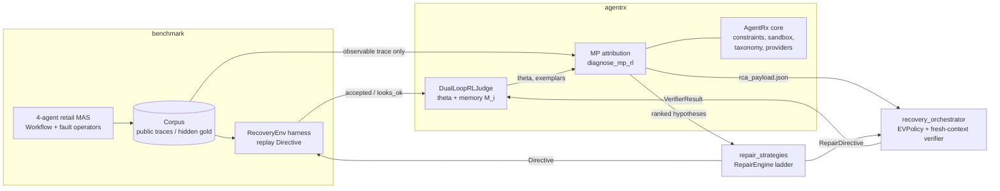
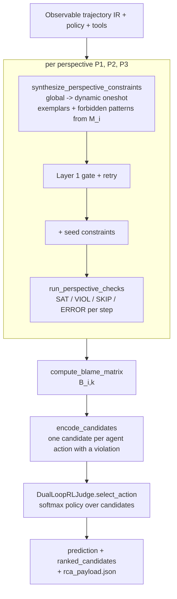
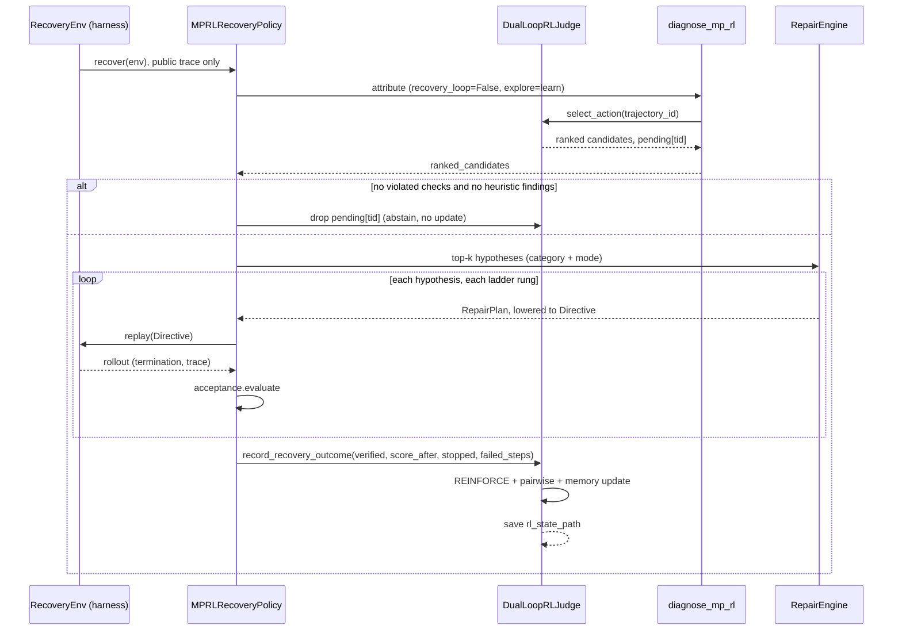

# AgentReroute: High-Level Design

How the multi-perspective (MP) fault attributor was integrated with AgentRx, and how the dual-loop RL
policy learns from recovery outcomes. Written against branch `mp_rl` at `955bfd4`.

"MP" = **multi-perspective**: the AgentRx single-pass checker/judge is replaced by three
taxonomy-scoped lenses (P1/P2/P3) whose violations feed a deterministic blame matrix and a learned
ranking policy. "RL" = the **dual-loop** that updates that policy (numeric loop) and the constraint-prompt
memory (verbal loop) from observable recovery feedback.

---

## 1. System at a glance

AgentReroute is a causal-recovery stack for multi-agent systems (MAS): *find the first fault, decide
whether and where to intervene, repair, replay, verify*. Seven packages, one data flow.

| Package | Role | Depends on |
|---|---|---|
| `benchmark` | Fault-injected 4-agent retail MAS, hidden gold, corpus, replayable recovery harness, scoring | stdlib |
| `agentrx` | Fault attribution (AgentRx reconstruction) **plus** the MP + RL extension (`perspectives.py`, `rl_policy.py`, `rl_cross_branch.py`) | `benchmark`, `repair_strategies`, `recovery_orchestrator` (only in `rl_cross_branch.py`) |
| `repair_strategies` | Typed repair ladder per fault category (`RepairEngine`, `RepairPlan`, acceptance checks, lowering) | stdlib |
| `recovery_orchestrator` | Decide, roll back, repair, replay, **fresh-context verify**, under budget | stdlib; reads attribution only through JSON |
| `tool_prevention`, `tool_middleware` | Pre-execution tool guards (prevention, not recovery) | stdlib |
| `demo` | Offline Versailles visualizer of propagation and recovery | `benchmark`, `agentrx` |

Only `agentrx/rl_cross_branch.py` imports across the attribution/recovery boundary (plus one lazy
back-import in `benchmark/scoring/recovery.py` that exposes `MPRLRecoveryPolicy` to the harness); the
orchestrator (AST-tested) and `repair_strategies` do not import `agentrx`, and talk to attribution through
files (`rca_payload.json`) or plain dicts.



---

## 2. How MP sits on top of AgentRx

### 2.1 What AgentRx does (baseline, `protocol = joint | step_then_category | ranked`)

```
trace -> LLM global constraints -> LLM dynamic constraints (per step or oneshot)
      -> check each constraint at each step (guard -> python sandbox | NL judge)
      -> violations -> ONE LLM judge call -> {step, agent, category}
```

One flat constraint set, one LLM judge. Reproducible, but the judge is a single point of failure and its
choice is not learnable.

### 2.2 What MP changes

`pipeline.diagnose()` dispatches on `config['protocol'] == 'mp_rl'` to `diagnose_mp_rl()`.
Everything below the judge is **reused unchanged**; everything from constraint synthesis up is replaced.

| Concern | AgentRx baseline | MP (`mp_rl`) |
|---|---|---|
| Constraint schema, `guard_matches`, `check_constraint`, python worker sandbox | AgentRx | **Reused as is** (`agentrx/constraints.py`, `worker.py`) |
| Taxonomy (9 categories + `Inconclusive`) | AgentRx | Reused; each category owned by exactly one perspective |
| Providers (`HTTPProvider`, `OllamaProvider`, `CachedProvider`), `validate_prediction`, resumable experiments | AgentRx | Reused; the `CachedProvider` hash includes retry feedback, so a retry is a fresh call |
| Constraint synthesis | 1 global + 1 dynamic set, whole taxonomy | **Per perspective**: global then dynamic (oneshot), taxonomy subset only, plus deterministic seed checks |
| Constraint admission | schema validation | **Layer 1 gate**: schema, python AST check, placeholder-copy rejection, runtime dry-run on the real trace, anti-repeat fingerprints, retry with `FORBIDDEN OUTPUT` feedback |
| Localization | LLM judge | **No judge call**: blame matrix, then 10-d candidate features, then learned softmax policy |
| Output | `prediction` | `prediction` + `ranked_candidates` + `rca_payload.json` (contract for the orchestrator) |
| Learning | none | Dual loop (section 4) |

The prediction schema is unchanged, so `evaluation.score`, the experiment runner and the benchmark's
attribution scoring consume MP output without modification.

### 2.3 The three perspectives

| Perspective | Owns categories | Lens |
|---|---|---|
| `P1_INTENT_PLAN` | Instruction/PlanAdherence, IntentPlanMisalignment, UnderspecifiedUserIntent, IntentNotSupported | intent, policy, plan, routing, unsupported or underspecified requests |
| `P2_TOOL_EXECUTION` | InvalidInvocation, GuardrailsTriggered, SystemFailure | schema validity, required args, tool errors, stuck `processing` status |
| `P3_HANDOFF_GROUNDING` | InventionOfNewInformation, MisinterpretationOfToolOutput | grounding in prior outputs, fabricated ids or amounts, handoff context |

Each perspective yields two kinds of constraint:

* **LLM constraints** (`origin='llm'`): synthesized under the perspective's taxonomy subset, gated by Layer 1.
* **Seed constraints** (`origin='seed'`): deterministic python checks authored in `perspectives.py`
  (empty or duplicate messages, write claims with no write call, routing drift and repeated calls,
  tool-error or stuck status, success claims after an empty tool output, handoff context and dollar
  grounding). Guarded so they judge only the steps their rule applies to, so vacuous SATs do not dilute
  the violation ratio. They run in-process (`_check_seed_inprocess`); LLM code stays in the worker sandbox.
  They are the **floor**: with `evidence=False` or a dead provider, MP still produces candidates with zero LLM calls.

A guard-relaxation rule (`run_perspective_checks`) retries an LLM constraint once with a wildcard trigger
if it SKIPs every step (e.g. it guarded on `role_name="retail_agent"` while the trace says `assistant`).

---

## 3. MP attribution pipeline (`diagnose_mp_rl`)



**Blame matrix** (per perspective *i*, autonomous agent *k*):

`B[i][k] = V / (V + S + eps) * (1 - (t_min - 1) / T)`

where V and S are the VIOL and SAT counts on *k*'s actions under lens *i*, `t_min` is the 1-based position
of *k*'s earliest violated action and T the trace length. Violation rate, discounted for later onset
(a fault that appears earlier is more likely causal). Tool outputs are attributed to the agent that
issued the call (`step_actor`); user, system and tool roles are never blamed.

**Candidate features** (`FEATURES = 10`, one candidate per agent action with a violation; if nothing is
violated, one per agent action ranked by the temporal prior):

| Index | Feature |
|---|---|
| 0-2 | blame of *k* under P1, P2, P3 |
| 3-5 | violation density at this step under P1, P2, P3 (`min(1, n/2)`) |
| 6 | share of the step's violations that came from python checks (`min(1, n/2)`) |
| 7 | temporal prior `1 - offset/T` |
| 8 | breadth: perspectives that fired / 3 |
| 9 | max density |

The dominant perspective (max of density + blame) fixes the candidate's category, taking the most frequent
`taxonomy_targets` among its violations within that lens.

**Artifacts** written per trace: `perspectives.json` (constraints, synthesis log, verdict counts),
`checks.json`, `validation_log.json`, `blame_matrix.json` (matrix, current theta, candidates),
`rl_recovery.json`, `rca_payload.json`, `result.json`.

**Call budget** (evidence mode): per perspective at most 2 synthesis stages x (1 + 2 retries) calls, plus
one NL-judge call per guarded step per `nl_check` constraint. There is **no judge call**.

---

## 4. The RL loop

### 4.1 Framing

Attribution is a **contextual bandit** over a small candidate set (typically 1-4 per trace): choose which
(agent, step) to repair, observe one scalar reward from recovery, update. It is not a multi-step MDP;
credit assignment is one-hop (the chosen candidate gets the reward). The "dual loop" is two coupled learners:

| Loop | State | Learns | Signal |
|---|---|---|---|
| **Numeric** (policy) | `theta` in R^10, EMA baseline, action counts | which evidence features predict a repairable root cause | REINFORCE + pairwise ranking |
| **Verbal** (memory `M_i`) | `PromptMemoryBank`: exemplar constraints + `ForbiddenPatternMemory` | which LLM-written constraints are worth reusing, which outputs to never emit | per-episode reward credited to constraints that fired |

### 4.2 Policy (`DualLoopRLJudge`)

* Logit `z = theta . h(candidate)`; `theta0 = (0.8, 0.9, 0.85, 1.1, 1.3, 1.2, 1.5, 0.9, 0.7, 1.2)` is a hand-set
  prior (python-check evidence and P2 density weigh most), so an untrained policy is already a sensible
  heuristic ranker.
* `p = softmax(z / tau)`, `tau = 0.5`. Ranked list sorted by `p`, ties to the earlier step.
* Optional exploration (`explore=True`, used when learning): `z += alpha * sqrt(ln(N+1) / (n_a + 1))`, a UCB
  bonus per action key `agent@step`, `alpha = 0.1`.
* `select_action(..., trajectory_id=)` stores `{candidates, probs, top1}` in `pending[trajectory_id]`.
  The later reward must reference that id; this is what binds a delayed recovery outcome to the decision
  that caused it.

### 4.3 Updates

* **REINFORCE with baseline:** `theta += lr * (R - b) * (h* - sum_j p_j h_j)`, `lr = 0.05`, `b` an EMA of R
  (decay 0.9), `R` clipped to [-1, 1].
* **Pairwise ranking update** (`record_recovery_outcome`, only when `R > 0`): for candidates that were
  replayed and rejected *before* the rewarded one, `theta += 0.15 * (h_chosen - h_failed)`. This teaches
  the order in which hypotheses should be tried, not only whether the top-1 was right.
* **Memory update:** the LLM-origin constraints whose names appear in the chosen candidate's
  `violated_checks` under its dominant perspective get `uses += 1`, `total_reward += R`, verified or failed
  counts. Exemplars are retrieved for synthesis only if `verified > failed`, ranked by
  `Q = mean R + c * sqrt(ln(N+1) / (n+1))` (UCB, `c = 0.5`), top 2. Layer-1 rejections and repairs with
  `R < 0` are fingerprinted into the forbidden set and injected back as `forbidden_patterns` (top 5).

### 4.4 Where the reward comes from

Three feedback sources, one per integration path. All are **observable**; none reads gold labels, the
`ScoreLedger`, episode rewards or `gold_state_hash`.

| Path | Entry point | Reward function | Verifier |
|---|---|---|---|
| **A. Standalone loop** | `diagnose_mp_rl(recovery_loop=True)` | `verify_and_score_state_change` (C4/C5) | Re-run the same constraints on the repaired window |
| **B. Benchmark harness** | `MPRLRecoveryPolicy` | `verifier_reward` | `repair_strategies.acceptance` + `termination == user_stop`; `looks_ok` for partial credit |
| **C. Orchestrator** | `MPRLOrchestratorSession` | `verifier_reward` | `recovery_orchestrator` fresh-context `VerifierResult` |

**Path A reward** (3-layer split-role check of the regenerated step *t\** and its successor):

| Outcome | R |
|---|---|
| Layer 1 fails (repair rejected by the gate) | -1 |
| Total violations drop and no *other* perspective regressed | `+max(0.25, dV/max(V_before,1))` |
| No improvement, or improvement vetoed by another lens (Layer 3) | -0.1 |
| Violations increase | `min(-0.25, dV/max(V_before,1))` |

`dV = V_before - V_after`. Path A is self-referential (the checks that picked the candidate also grade the
repair), which is why Layer 3 (cross-lens regression veto) exists and why B and C use external verifiers.

**Paths B and C reward** (`verifier_reward`): `+1` if verified; `-1` if a rollout was stopped early
(loop or truncation) and nothing verified; otherwise `min(-0.1, 0.5*dScore - 0.5)` with
`dScore = score_after - score_before`, so unverified repairs stay negative but rank by improvement.
In path B, `score_after` is `1.0` verified, `0.5` if the last rollout `looks_ok`, else `0.0`. In path C it is
the best verifier score over attempts. Credit goes to the candidate that produced the verified repair
(`_CreditEngine.current` in B, last attempt's primary step in C); candidates tried earlier become
`failed_steps` for the pairwise update.

### 4.5 Closed loop (path B, the benchmark path)



Path C is the same shape with `Orchestrator.run(trace, RCAPayload)` replacing the harness loop: the EV policy
picks (rollback point, strategy), `OrchestratorRepairer` builds the directive from the same
`RepairEngine`, the fresh-context verifier gates success, and the verdict is the reward.

### 4.6 Training and evaluation protocol

`train_and_evaluate_benchmark(corpus, train_split, test_split, epochs)`: learn `theta` and `M_i` on the
train split from observable feedback, then **freeze** (`learn=False`) and evaluate on the held-out test
split. `train_history[].harness_recovery_rate` is the ledger-scored metric, recorded for the learning
curve and **never fed back**.

### 4.7 State and persistence

The `rl_state_path` JSON holds `weights`, `baseline_reward`, `action_counts`, `episodes`, `pairwise_lr`, and
the full memory bank. `pending` is deliberately **in-process only**: a crash between `select_action` and the
outcome loses that one update, nothing else.

---

## 5. Bridging attribution and repair

Attribution speaks AgentRx categories; repair and the harness speak the benchmark's seven failure modes.
`candidates_to_benchmark_hypotheses` maps `{category -> mode}` via `benchmark.taxonomy.from_agentrx`, then
`_fault_label` applies two refinements the category alone loses:

* P3 handoff-grounding seed firing on a `handoff` step: `(MisinterpretationOfToolOutput, context_propagation)`.
* P2 stuck-`processing` tool output, or P1 routing seed firing on a tool-call step (a 3rd identical call):
  `(Cycle, cycles)`.

`_repairable` drops a `mode` that does not refine its category (`Hypothesis.from_mapping` would reject it),
so the repair side then gets the category alone.

`RepairEngine.propose` walks the fault's ladder by `rung`, skips rungs already `FAILED` or `REJECTED`, and
ends with a single fallback (roll back side effects, escalate). Example ladders: `Cycle`: nudge, force
change, replan, rollback; `MisinterpretationOfToolOutput`: handoff patch, structured reading, independent
reading, cross-source check; `InvalidInvocation`: hard-call repair, schema-drift switch.
`lower(plan, BACKEND)` degrades operations a backend cannot run into guidance text and records it, so
strategy quality is separable from backend limits.

**Abstention** lives in the policy, not in `diagnose_mp_rl` (which always emits at least the temporal-prior
candidates): `MPRLRecoveryPolicy.attribute` returns `[]` when no candidate has a violated check *and*
`heuristic_findings(trace)` is empty, so a healthy run triggers neither repair nor an RL update.

---

## 6. Trust boundaries

| Boundary | Rule | Enforced by |
|---|---|---|
| Gold vs decision path | Gold actions, rewards and labels are read only in scoring modules | `recovery_orchestrator/tests/test_leakage.py` (AST scan); `public/` vs `gold/` corpus split |
| Reward path | Ledger rewards are written by the env and read only by the harness | `RecoveryEnv`; B and C use acceptance and verifier signals |
| Verifier independence | The fresh-context verifier sees the task view plus the final transcript only, never the directive, RCA rationale, strategy or original trace | `recovery_orchestrator/verifier.py` tests |
| Code execution | LLM-authored python runs in a disposable worker with a restricted builtin set; only repo-authored seeds run in-process | `worker.py`, `_check_seed_inprocess` |
| Attribution vs orchestrator | The orchestrator never imports `agentrx`; the contract is `rca_payload.json` | `RCAPayload.from_dict` |
| Demo | `MPRLRecoveryPolicy` on observable data only; scenario ids do not name the fault | `demo/tests` |

Trace views: `full` (used for replay) and `output_only` (agent inputs and system prompts stripped, used for
attribution).

---

## 7. Evaluation substrate

`benchmark` generates failures by **paired fault injection**: run clean, require pass^k = 1 for eligibility,
inject one operator (DropContext, Misroute, SkipWrite, ...) at a site of the clean run, keep the pair only if
the fault fired and caused the failure. Gold records the fault step (`Step.faults`) and the critical step.
Replays reproduce the pre-rollback prefix from cache, apply a `Directive` (`guidance | resample | none`),
and run the remainder live. Scoring: attribution (step, agent, mode), detection, recovery with budget caps,
controls (`unmodified` replay), bootstrap CIs and McNemar.

---

## 8. Configuration and operation

| Knob | Where | Effect |
|---|---|---|
| `protocol: mp_rl` | agentrx config | selects MP attribution |
| `evidence` | config | `false` = seed checks only, zero LLM calls |
| `recovery_loop` | config | path A on or off |
| `rl_state_path` | config / policy | load and save theta and memory |
| `rl_explore` | config | UCB exploration in `select_action` |
| `use_llm_synthesis`, `learn`, `max_hypotheses` | `MPRLRecoveryPolicy` | LLM-written constraints, online updates, repair breadth |

Providers: `ollama` (local), `gemini`, `openai`, any OpenAI-compatible endpoint (OpenRouter included). The
HTTP provider retries with backoff, strips `<think>` and fences from JSON, sends Cloudflare-safe headers and
falls back without `response_format` on a 400. Keys resolve from the process environment, then the Windows
user registry only if the variable is absent (an empty value disables the fallback).

Verification: `python -m agentrx test` and `check`, plus per-package `unittest discover`.

---

## 9. Known limitations and threats to validity

1. **Seed rules are domain-tuned.** Several seed regexes (e.g. `WRITE_CLAIM`) enumerate the completion
   phrases emitted by the benchmark's own fault operators (`benchmark/faults/operators.py:CLAIMS`). MP
   therefore partly detects faults by their known surface form. Any accuracy claim on this benchmark is an
   upper bound until evaluated on external traces (the AgentRx tau and Magentic-One release) or with the
   seeds ablated.
2. **No measured MP-vs-AgentRx result yet.** The live head-to-head on OpenRouter was stopped after one
   trace (both systems localized the right step and agent and both recovered; mp_rl also got the mode right).
   One trace is an anecdote, not evidence.
3. **Hand-set `theta0`.** Weights are a prior, not tuned. With 1-4 candidates per trace and small train
   splits, expect high variance; report seeds and CIs, and compare against the frozen `theta0` ranker.
4. **Path A reward is self-graded.** Use B or C for any reported number.
5. **Credit assignment is one-hop.** A verified repair at a downstream symptom step credits that candidate
   even if the true root cause was upstream; the pairwise update partly corrects ordering but not causation.
6. **`pending` is not persisted**, and `PromptMemoryBank` has no decay or size bound.
7. **Keyword heuristics** (`SUCCESS_CLAIM`, `ID_TOKEN`) can false-positive on negations; NL constraints are
   the intended backstop.

---

## 10. Research map

| Component | Basis |
|---|---|
| Constraint synthesis, guarded checks, taxonomy | AgentRx (arXiv 2602.02475); reconstruction in `agentrx/` |
| Fault injection operators | MAS-FIRE-style prompt mutation, response rewriting and routing faults; ToolMaze tool-fault grid |
| Policy update | REINFORCE with an EMA baseline (Williams 1992), applied as a contextual bandit; the pairwise term is a Bradley-Terry-style ranking nudge |
| Exploration and exemplar scoring | UCB1 (Auer et al. 2002) |
| Verbal loop | Reflexion-style memory of verified and failed attempts, with UCB-ranked exemplar retrieval and a negative (forbidden) memory |
| Split-role verification | Independent checker with no access to the repair's reasoning; see `recovery_orchestrator/README.md` for the supporting literature |

Suggested ablations: seeds off; single perspective; frozen `theta0` vs learned; uniform vs UCB exemplars;
reward source A vs B vs C; judge-LLM baseline (`joint`) at equal call budget.
