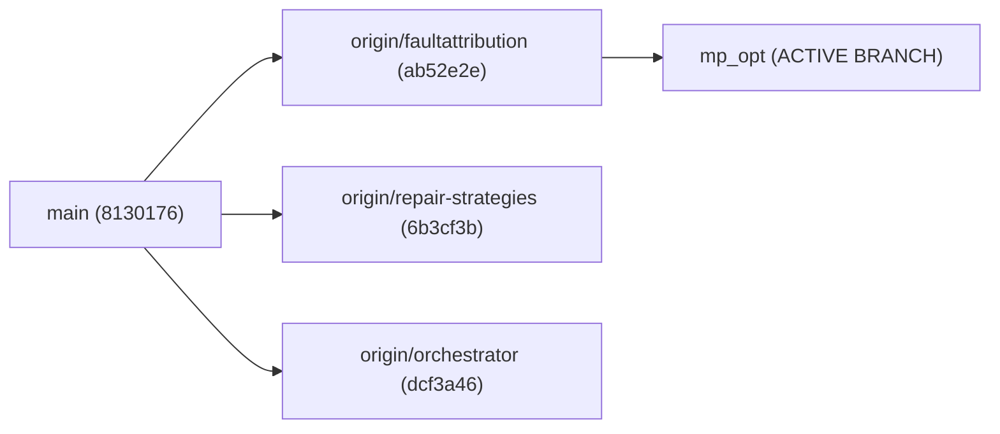
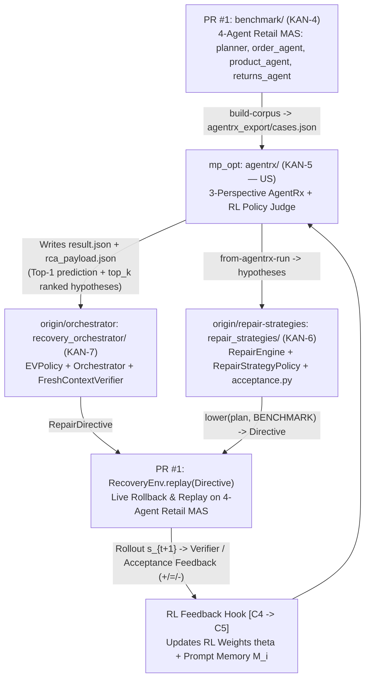
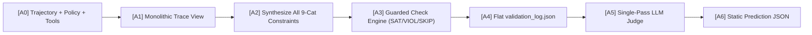
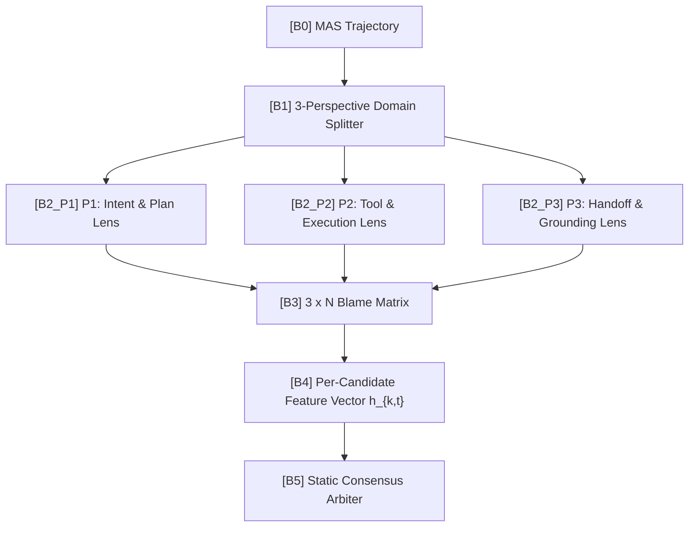
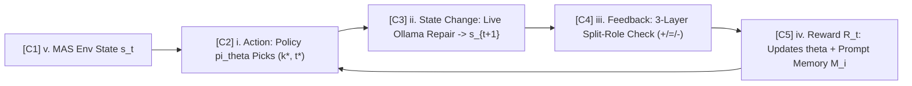
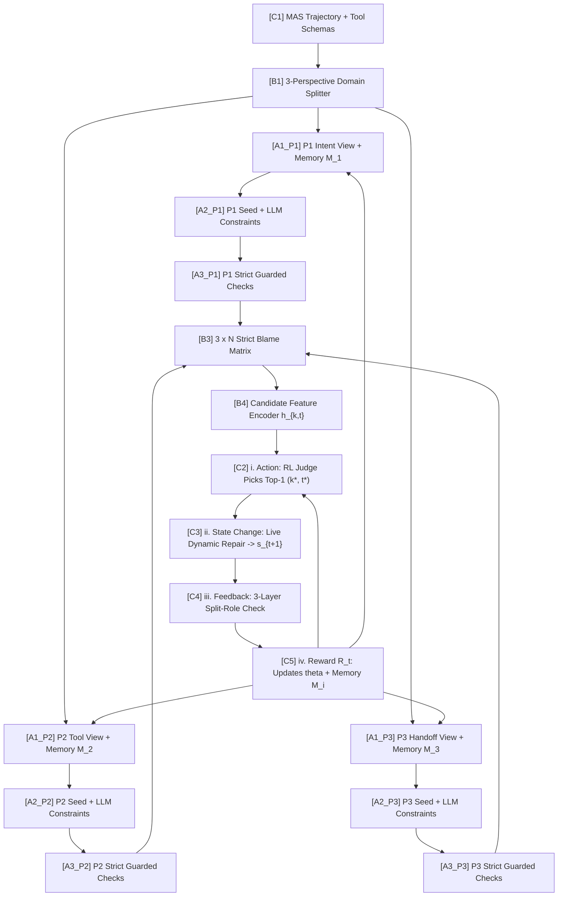

# AgentReroute Phase 2 (`mp_opt`): Master Context, Software Requirements Document (SRD), Solution Architecture & Claude Code Implementation Guide

> [!IMPORTANT]
> **Purpose of This Single-File Master Specification & Two-Stage Rollout Strategy**:
> This document consolidates **100% of the repository context, architectural decisions, Software Requirements Document (SRD), High-Level & Low-Level Solution Design (HLD/LLD), Mathematical Formulations, Fact-Enforced Trap Mitigations, and Step-by-Step Implementation Instructions** required for:
> 1. **Stage A (Immediate Implementation on `mp_opt` by Claude Code — Fully Decoupled)**: Implement Multi-Perspective (`[B1 -> B2 -> B3 -> B4]`) + the decoupled `DualLoopRLJudge` (`[C2 -> C5]` standalone mode) inside `agentrx/`, emitting `result.json` and `rca_payload.json` with zero cross-branch imports so `mp_opt` merges cleanly into `main`.
> 2. **Stage B (Team Proposal Tomorrow & Post-Merge RL Branch)**: Present the RL Solutioning (Part III) to the team, merge `benchmark` (PR #1), `faultattribution`/`mp_opt`, `repair-strategies`, and `orchestrator` into `main`, and cut the dedicated RL branch that wires `RecoveryEnv.replay()` + `FreshContextVerifier` / `acceptance.evaluate()` into `DualLoopRLJudge.record_recovery_outcome()`.

---

## Table of Contents
1. [Part I: Complete Project Context & Decisions Log](#part-i-complete-project-context--decisions-log)
2. [Part II: Software Requirements Document (SRD)](#part-ii-software-requirements-document-srd)
3. [Part III: Detailed Solutioning & Architecture Document (HLD + LLD)](#part-iii-detailed-solutioning--architecture-document-hld--lld)
4. [Part IV: Step-by-Step Implementation Instructions for Claude Code](#part-iv-step-by-step-implementation-instructions-for-claude-code)

---

# Part I: Complete Project Context & Decisions Log

## 1. Repository & Multi-Branch Topology

`e:\Projects\AgentReroute` is organized into four workstreams across git branches. **All Phase 2 work takes place on the `mp_opt` branch.**



| Branch / Package | Role in AgentReroute | Key Files & Status |
| :--- | :--- | :--- |
| **`mp_opt` (Active)** | **Part 1 & 2: Benchmark + Multi-Perspective (MP) & RL Fault Attribution (`agentrx`)** + Pre-execution Tool Prevention (`tool_prevention`) | `agentrx/cli.py`, `agentrx/pipeline.py`, `agentrx/constraints.py`, `tool_prevention/gateway.py` |
| **`origin/faultattribution`** | Track B ranked-list handoff (`boundary.py`, `handoff.py`, `predictions.py`) | **Frozen for Phase 2 (`D-03`)** — RL outputs Top-1 now and extrapolates to Top-$K$ later. |
| **`origin/repair-strategies`** | Typed `RepairPlan` rungs, `acceptance.py`, and `LessonMemory` (`memory/lessons.py`) | Design patterns (`LessonMemory`, rung escalation) adapted into `agentrx/rl_policy.py`. |
| **`origin/orchestrator`** | `ReplayEnvironment`, `FreshContextVerifier` (`verifier.py`), `ScoreLedger` (`replay.py`) | Design patterns (`FreshContextVerifier`, prefix rollback) adapted into `agentrx/rl_policy.py`. |
| **`origin/pr-1` (PR #1 `benchmark/`)** | **Part 1: Replayable 4-Agent Retail MAS (`planner`, `order_agent`, `product_agent`, `returns_agent`) + 7 Fault Operators + `RecoveryEnv.replay(Directive)`** | `benchmark/env/workflow.py`, `benchmark/scoring/recovery.py`, `benchmark/scoring/baselines.py` (`from_agentrx_run`), `docs/pilot-2026-10-20.md` |

### 1.1 Cross-Branch Reality Check (How PR #1 `benchmark`, `repair-strategies`, `orchestrator`, and `mp_opt` Connect)



| RL Paradigm Stage | What Exists on the Other Branches Right Now | How `mp_opt` Implements & Connects It |
| :--- | :--- | :--- |
| **`v. Environment` (Replayable MAS)** | **PR #1 (`benchmark/env/workflow.py` & `benchmark/scoring/recovery.py`)** implements a real 4-agent retail MAS (`planner`, `order_agent`, `product_agent`, `returns_agent`) with `RecoveryEnv.replay(Directive)`. **Crucial Fact**: In `benchmark/importers.py#L28`, the 73 external AgentRx traces (`data/benchmark/cases.json`) are marked `replayable: False`; only PR #1's generated multi-agent retail corpus (`train`/`calibration`/`test` splits) is replayable in `RecoveryEnv`. | `agentrx/rl_policy.py` supports **Two Execution Modes**:<br>• **Mode 1 (Standalone on `mp_opt`)**: Uses `live_dynamic_recover` (`[C3]`) for 1-step counterfactual state transition $s_t \rightarrow s_{t+1}$ on any trace.<br>• **Mode 2 (Cross-Branch with PR #1 + `repair-strategies` / `orchestrator`)**: Plugs directly into `RecoveryEnv.replay(Directive)` or `Orchestrator.run()` via `record_recovery_outcome(...)`. |
| **`i. Action` (Judge chooses Agent $k^*$ / Step $t^*$)** | Consumed by **PR #1** via `from_agentrx_run` (`benchmark/scoring/baselines.py#L168`, which reads `jobs/<variant>/rep-<n>/<domain>/<hash>/result.json`) and by **`origin/orchestrator`** via `load_payload` (`recovery_orchestrator/rca.py#L358`, which looks for `rca_payload.json` first and falls back to `result.json`). | `diagnose_mp_rl` writes **both**:<br>1. `result.json` (`prediction` = Top-1 `(agent, step_index, category)` for `from_agentrx_run` and `agentrx evaluate`).<br>2. `rca_payload.json` (in the exact `RCAPayload.to_dict()` schema expected by `recovery_orchestrator/rca.py#L271`, including `top_k` up to 3 ranked candidates, `confidence`, and `ranked_probabilities`). |
| **`ii. State Change` (Recovery fixes Agent $k^*$)** | Already built in **`origin/repair-strategies`** (`RepairStrategyPolicy.recover(env)` in `adapters/benchmark.py#L90` and `OrchestratorRepairer` in `adapters/orchestrator.py`) + **PR #1** (`RecoveryEnv.replay(directive)`). | When running with the sibling branches, `RepairStrategyPolicy` or `Orchestrator` takes our `rca_payload.json` / `hypotheses`, rolls back the 4-agent workflow to `rollback_step`, applies the typed repair plan, and replays the workflow to produce `Rollout` $s_{t+1}$. |
| **`iii. Feedback` ($+ / - / =$ without Gold Leakage)** | Already built in:<br>1. `repair_strategies/acceptance.py`: `acceptance.evaluate(plan, rollout_trace, task)`<br>2. `recovery_orchestrator/verifier.py`: `FreshContextVerifier.verify(task, rollout)` (`passed: bool`, `score: 0..1`)<br>3. `benchmark/scoring/recovery.py`: `looks_ok(rollout)` | **Strict Leakage Boundary**: Both PR #1 (`test_leakage_cli.py`) and `origin/orchestrator` (`test_leakage.py`) prohibit policies from reading `ScoreLedger` (ground-truth DB reward). Therefore, online RL reward $R_t$ is computed strictly from **observable verifier/acceptance feedback** (`VerifierResult.passed`, `VerifierResult.score`, `acceptance.evaluate().passed`, and `[A3_Pi]` violation delta $\Delta V$). |
| **`iv. Reward` (Closing the Loop Back to `mp_opt`)** | Currently 1-way (`agentrx` writes static JSON files and never receives recovery outcomes back). | `DualLoopRLJudge.record_recovery_outcome(trajectory_id, chosen_step, chosen_agent, accepted, verifier_score, rollout_trace)` closes the loop so outcomes from either standalone `[C3->C4]` or cross-branch `Orchestrator` / `RecoveryEnv` update $\theta$ and `PromptMemoryBank` $\mathcal{M}_i$. |

---

## 2. Existing `mp_opt` Codebase Map & Exact Interfaces

Claude Code **must preserve backward compatibility** with all existing modules and tests (`python -m agentrx test` and `python -m agentrx check`).

| File | Exact Functions / Classes & Signatures | Key Implementation Notes |
| :--- | :--- | :--- |
| `agentrx/taxonomy.py` | `CATEGORIES: tuple[str, ...]` (10 items: 9 substantive + `'Inconclusive'`)<br>`category(value) -> str`<br>`agent(value) -> str`<br>`taxonomy(checklist=False) -> list[dict]` | The 9 substantive categories (`CATEGORIES[:9]`) are partitioned across Perspectives $P_1, P_2, P_3$. |
| `agentrx/data.py` | `normalize(raw, domain, fallback_id=None) -> dict`<br>`normalize_gold(raw) -> dict`<br>`load_corpus(directory) -> tuple[list[dict], dict]`<br>`validate_case(case) -> None` | Normalized Trajectory IR schema:<br>`{'trajectory_id': str, 'domain': 'tau'|'magentic'|..., 'instruction': str, 'instruction_source': str, 'steps': [{'index': int, 'substeps': [{'sub_index': int, 'role': str, 'content': str, 'tool_calls': list, 'name': str}]}], 'index_map': list}` |
| `agentrx/constraints.py` | `TYPES = {'SCHEMA', 'PROTOCOL', 'RELATIONAL_POST', 'PROVENANCE', 'TEMPORAL', 'CAPABILITY', 'ANY'}`<br>`validate_constraint(raw: dict) -> dict`<br>`guard_matches(c: dict, step: dict) -> bool`<br>`prefix(trajectory: dict, offset: int) -> dict`<br>`check_constraint(raw, trajectory, offset, provider, context) -> dict` | `check_constraint` returns:<br>`{'step_index': int, 'assertion_name': str, 'verdict': 'SAT'|'VIOL'|'SKIP'|'ERROR', 'taxonomy_targets': list[str], 'constraint_type': str, 'check_type': 'python_check'|'nl_check', 'check_hint': str, ...}` |
| `agentrx/worker.py` | Restricted subprocess runner invoked via `sys.executable -I -S worker.py` | Executes `python_check` code in a sandboxed namespace (`json, re, math, statistics, collections, datetime, itertools, functools, decimal, fractions, operator`). |
| `agentrx/prompts.py` | `PROMPT_VERSION = 'agentrx-reconstruction-v1'`<br>`CONSTRAINT_SCHEMA: dict`<br>`messages(stage: str, payload: dict) -> list[dict]`<br>`prompt_identity() -> str` | **CRITICAL**: `CachedProvider.complete(stage, payload)` calls `messages(stage, payload)` to build the cache hash. Any new stage name MUST be handled inside `messages(stage, payload)`. |
| `agentrx/providers.py` | `HTTPProvider.from_config(config)`<br>`OllamaProvider(config)`<br>`ReplayProvider(path)`<br>`CachedProvider(provider, directory, namespace)` | `provider.complete(stage: str, payload: dict) -> dict` always expects and returns a JSON `dict`. |
| `agentrx/pipeline.py` | `DEFAULTS = {'evidence': True, 'checklist': True, 'generation': 'stepwise', 'protocol': 'joint', 'python_timeout': 3}`<br>`validate_config(config: dict) -> dict`<br>`validate_prediction(raw: dict, trajectory: dict, require_category=True) -> dict`<br>`diagnose(trajectory, policy, tools, config, provider, artifacts) -> dict` | `validate_config` (L11–19) and `experiment_variants` in `experiments.py` (L40) validate allowed variant keys and protocol names. |
| `agentrx/evaluation.py` | `METRIC_NAMES: tuple[str, ...]`<br>`score(prediction: dict | None, gold: dict) -> dict`<br>`aggregate(cases, predictions_by_rep) -> dict` | Computes `step_accuracy`, `acc_at_1`, `acc_at_3`, `acc_at_5`, `average_step_distance`, `agent_accuracy`, `critical_category_accuracy`, `any_category_accuracy`, `earliest_category_accuracy`, `terminal_category_accuracy`. |
| `tool_prevention/contracts.py` | `fingerprint(value) -> str`<br>`action_hash(tool, args, customer, session, policy_version) -> str` | Canonical SHA-256 JSON fingerprinting pattern reused for Layer 1 Anti-Repeat output hashing. |

---

## 3. Benchmark Corpus Facts (`data/benchmark/cases.json`)

- **Total Validated Trajectories**: **73 failed runs** (`data/benchmark/manifest.json`):
  - **`tau` (tau-bench retail)**: **29 trajectories**. Single autonomous agent role `assistant` interacting with `user` and `tool` roles across 10–39 steps, backed by retail domain policy and 15 retail tool schemas.
  - **`magentic` (Magentic-One)**: **44 trajectories**. Multi-agent system with 4–5 distinct agents (`Orchestrator`, `WebSurfer`, `FileSurfer`, `Coder`, `ComputerTerminal`) collaborating across multi-step plans.
- **Empirical Fact from `docs/verification.md` (L112–115)**:
  - Live Ollama runs with `Huihui-Qwen3-VL-8B` / `qwen2.5-coder:7b` on retail trace 2 (32 steps) produced **64 SKIP / 0 VIOL / 0 SAT** in `oneshot` and **42 SKIP / 0 VIOL** in `stepwise` mode because the 7B/8B model synthesized overly narrow `event_trigger` guards (`step_index` + strict `content_regex`).

---

## 4. Locked Architectural Decisions (`D-01`..`D-11`) & Deferred Scope (`S-01`..`S-05`)

### Locked Decisions (Active Scope)
| ID | Decision | Architectural Mandate |
| :--- | :--- | :--- |
| **D-01** | **Keep the 9 Paper Categories** | Use the 9 substantive categories in `agentrx/taxonomy.py` (`CATEGORIES[:9]`) + `Inconclusive`. |
| **D-02** | **Use Current 73-Case Benchmark** | Operate on `data/benchmark/cases.json` (29 `tau` + 44 `magentic`). |
| **D-03** | **Top-1 Output Now (Top-$K$ Ready)** | Freeze Track B handoff; output Top-1 `(agent, step_index, category)` prediction dict compatible with `validate_prediction()`, while storing the full ranked candidate list in `result['ranked_candidates']` for future Track B extrapolation. |
| **D-04** | **Local Ollama Provider** | Default to `OllamaProvider` (`configs/dev_ollama.json`); keep provider interface agnostic so Gemini/OpenAI work without code changes. |
| **D-05** | **Focus on Phase 2 Only** | Implement Multi-Perspective (MP) + Lightweight RL integration. Leave out Phase 3. |
| **D-06** | **3 Exhaustive Perspectives (No Ego-Perspectives)** | Partition the 9 categories into 3 disjoint Perspectives:<br>• **$P_1$ (`P1_INTENT_PLAN`)**: Categories 1, 5, 6, 7<br>• **$P_2$ (`P2_TOOL_EXECUTION`)**: Categories 3, 8, 9<br>• **$P_3$ (`P3_HANDOFF_GROUNDING`)**: Categories 2, 4 |
| **D-07** | **Embed AgentRx `[A1->A2->A3]` Inside `[B2]`** | Within each Perspective $P_i$, build $P_i$'s view (`[A1_Pi]`), synthesize $P_i$-specific constraints (`[A2_Pi]`), and run AgentRx's strict `check_constraint` engine (`[A3_Pi]`) to populate the $(3 \times N)$ Blame Matrix (`[B3]`). |
| **D-08** | **Live Ollama State Change (`Mode A`)** | State Change (`ii`) uses live LLM generation (`[C3]`) to repair the chosen `(Agent k*, Step t*)` and dynamically generate the next step/tool response $s_{t+1}$. |
| **D-09** | **Dual-Loop RL ($\theta$ + Verbal Memory $\mathcal{M}_i$)** | RL updates **both** (1) numeric policy weights $\theta$ in `[C2]` and (2) a persistent Verbal/Exemplar Prompt Memory Bank $\mathcal{M}_i$ injected into Ollama prompts so Ollama's own reasoning improves over episodes. |
| **D-10** | **Deterministic Seed Floor + Guard Auto-Relaxation** | Every perspective includes deterministic `python_check` seed constraints (broad `step_type`/role guards, 0% `SKIP` collapse) and automatically relaxes synthesized `event_trigger` guards if a constraint yields 100% `SKIP`. |
| **D-11** | **Joint `(Agent k, Step t)` Action Space + 3-Layer Split-Role Verification + Anti-Repeat Gate** | RL scores `(Agent k, Step t)` candidates (preventing single-agent collapse on `tau-retail`), verifies repairs via 3-Layer Split-Role Verification, and prevents repeated rejected outputs via Fingerprint Blocklist + Compiler-Error Retry + Persistent Negative Memory + Rung Escalation. |

### Deferred Scope (Parked for Later)
- **S-01**: Cloud Gemini benchmark sweeps (`configs/dev_gemini.json`).
- **S-02**: Phase 3 workstream.
- **S-03**: Track B downstream consumption of `ranked_candidates`.
- **S-04**: Creative/unconstrained blame scoring (strict check engine used for Phase 2 baseline).
- **S-05**: Missing upstream benchmark domains (`flash`, `relwork`).

---

# Part II: Software Requirements Document (SRD)

## 1. Functional Requirements

### FR-01: Perspective Domain Splitter (`[B1]`)
- The system SHALL partition the 9 substantive failure categories from `agentrx/taxonomy.py` into 3 mutually exclusive, collectively exhaustive Perspectives:
  1. **`P1_INTENT_PLAN` (Intent & Plan Lens)**:
     - `Instruction/PlanAdherenceFailure` (Cat 1)
     - `IntentPlanMisalignment` (Cat 5)
     - `UnderspecifiedUserIntent` (Cat 6)
     - `IntentNotSupported` (Cat 7)
  2. **`P2_TOOL_EXECUTION` (Tool & Execution Lens)**:
     - `InvalidInvocation` (Cat 3)
     - `GuardrailsTriggered` (Cat 8)
     - `SystemFailure` (Cat 9)
  3. **`P3_HANDOFF_GROUNDING` (Handoff & Grounding Lens)**:
     - `InventionOfNewInformation` (Cat 2)
     - `MisinterpretationOfToolOutput` (Cat 4)

### FR-02: Perspective-Scoped View Builder (`[A1_Pi]` inside `[B2]`)
- For each perspective $P_i \in \{P_1, P_2, P_3\}$, the system SHALL construct a perspective-scoped payload containing:
  - Filtered taxonomy definitions (`taxonomy_subset`) containing ONLY $P_i$'s assigned categories.
  - Perspective-specific focus instructions (e.g., $P_1$ focuses on user instruction, policy rules, and orchestrator/assistant plans; $P_2$ focuses on `tool_calls`, tool schemas, and error outputs; $P_3$ focuses on cross-step provenance between tool/agent outputs and subsequent claims).
  - Top-$K$ verified positive exemplars and negative forbidden patterns retrieved from $P_i$'s `PromptMemoryBank` $\mathcal{M}_i$.

### FR-03: Hybrid Seeded + Synthesized Perspective Constraint Generation (`[A2_Pi]` inside `[B2]`)
- Each perspective $P_i$ SHALL combine:
  1. **Built-in Deterministic Seed Constraints (`SEED_CONSTRAINTS[P_i]`)**: Pre-validated `python_check` constraints with broad guards (`step_index: '*'`) that deterministically detect common structural faults in $P_i$'s domain (e.g., malformed/empty tool arguments or schema mismatches in $P_2$, ungrounded numeric/ID fabrication in $P_3$, empty/looping plan adherence failure in $P_1$).
  2. **LLM-Synthesized Perspective Constraints**: Synthesized via `provider.complete('perspective_global', ...)` and `provider.complete('perspective_dynamic', ...)` scoped to $P_i$'s categories.
- **Auto-Guard Relaxation (Trap 1 Fix)**: If an LLM-synthesized constraint produces `SKIP` on 100% of steps in a trajectory, the engine SHALL automatically relax `event_trigger['step_index']` and `event_trigger['content_regex']` to `'*'` and re-evaluate `check_constraint` once so overly narrow guards do not zero out the Blame Matrix.

### FR-04: Strict Guarded Check Execution per Perspective (`[A3_Pi]` inside `[B2]`)
- Each perspective $P_i$ SHALL execute `check_constraint` (`agentrx/constraints.py`) across all trajectory steps for its seed and synthesized constraints, recording `SAT`, `VIOL`, `SKIP`, and `ERROR` outcomes tagged with `'perspective': P_i`.

### FR-05: Strict $(3 \times N)$ Blame Matrix (`[B3]`) & Candidate Feature Encoder (`[B4]`)
- From `[A3_Pi]` check outcomes, `[B3]` SHALL compute:
  1. **Agent-Level $(3 \times N)$ Blame Matrix $B \in \mathbb{R}^{3 \times N}$** across all $N$ autonomous/participating agents in the trajectory:
     $$B_{i, k} = \left(\frac{V_{i, k}}{V_{i, k} + S_{i, k} + \epsilon}\right) \times \left(1 - \frac{t^{\min}_{i, k} - 1}{T}\right)$$
     where $V_{i,k}$ is the number of `VIOL` verdicts attributed to agent $k$ under perspective $P_i$, $S_{i,k}$ is the number of `SAT` verdicts, $t^{\min}_{i,k}$ is the earliest 1-based `step_index` where agent $k$ triggered a `VIOL` under $P_i$ (or $T$ if $V_{i,k}=0$), $T = \max(\text{len(steps)}, 1)$, and $\epsilon = 10^{-6}$.
  2. **Joint Candidate Set $\mathcal{C} = \{(k, t)\}$ (Trap 2 Fix)**: Every step $t$ (with acting agent $k$) that has at least one `VIOL` (or all non-user steps if 0 `VIOL`s exist) forms a candidate $(k, t)$ with a 10-dimensional feature vector $h_{k,t} \in \mathbb{R}^{10}$ produced by `[B4]`.

### FR-06: Lightweight Contextual RL Policy Judge (`[C2]` — `i. Action`)
- `[C2]` SHALL implement a trainable Contextual Linear-Softmax Policy $\pi_\theta(a \mid s)$ with parameter vector $\theta \in \mathbb{R}^{10}$ (plus optional UCB exploration bonus):
  $$p_\theta(k, t) = \frac{\exp(\theta^\top h_{k,t} / \tau)}{\sum_{(k', t') \in \mathcal{C}} \exp(\theta^\top h_{k',t'} / \tau)}$$
- It SHALL select the **Top-1 action $a^* = (k^*, t^*)$** (highest score) as the primary prediction and assign the dominant violated category $c^*$ from the highest-blamed perspective at $(k^*, t^*)$.
- It SHALL also store the full sorted list of candidates in `result['ranked_candidates']` so Track B can consume Top-$K$ later without modifying `[C2]`.

### FR-07: Live Dynamic Recovery & State Transition (`[C3]` — `ii. State Change`)
- Given the selected target $a^* = (k^*, t^*, c^*)$, `[C3]` SHALL construct the trajectory prefix $s_{\text{prefix}} = \text{steps}[1 \dots t^*-1]$ and generate a repaired step $t^{*\prime}$ for Agent $k^*$ via `provider.complete('perspective_repair', ...)`.
- **No Stale Response Reuse (Trap 3 Fix)**: To form the post-repair MAS state $s_{t+1}$:
  - If step $t^*+1$ in the original trace was a **MAS peer agent** (`Orchestrator`, `Coder`, `FileSurfer`, `assistant`, etc.), `[C3]` SHALL dynamically generate step $(t^*+1)'$ conditioned on the repaired prefix $[1 \dots t^{*\prime}]$.
  - If step $t^{*\prime}$ emits a **repaired tool call** `tool(new_args)` whose arguments differ from the broken step $t^*$, `[C3]` SHALL invoke the **Live Tool Executor / Dynamic Tool Sandbox** (`provider.complete('tool_sandbox', ...)`) or deterministic retail schema validator to produce a fresh tool observation $(t^*+1)'$ matching `new_args`, NEVER reusing the stale error response from step $t^*+1$.

### FR-08: 3-Layer Split-Role Verification & Anti-Repeat Gate (`[C4]` — `iii. Feedback`)
- `[C4]` SHALL evaluate whether the repaired state $s_{t+1}$ improved ($+$), stayed equal ($=$), or degraded ($-$) compared to $s_t$ using **3 orthogonal verification layers** (Trap 4 Fix):
  - **Layer 1 (Deterministic AST/Regex + Action-Structure Invariant + Anti-Repeat Gate)**:
    - Verifies that `python_check` constraints pass and that required structural action types (e.g., presence of valid `tool_calls` if step $t^*$ required a tool invocation) were not deleted to game the check.
    - **3-Stage Anti-Repeat Gate**:
      1. Computes `fingerprint(output)` (`sha256`). If Layer 1 rejects an output $y_{\text{bad}}$, it adds `fingerprint(y_bad)` to `seen_hashes` and retries (up to `max_retries=2`) by injecting the exact AST/regex failure reason and `"FORBIDDEN OUTPUT (DO NOT REPEAT): <y_bad>"` into the prompt payload (which automatically changes the `CachedProvider` request hash).
      2. Logs rejected patterns into `ForbiddenPatternMemory` inside $\mathcal{M}_i$ so future episodes pre-inject `"KNOWN INVALID PATTERNS TO AVOID"` before generation.
      3. If retry count $> 2$ or a duplicate hash is emitted, immediately terminates retry and escalates rungs (`Rung 1: Hint` $\rightarrow$ `Rung 2: Strict Schema Fill-in` $\rightarrow$ fail with $R_t < 0$).
  - **Layer 2 (Fresh-Context Blind Auditor)**:
    - Runs semantic `nl_check` on $s_{t+1}$ in a clean context that **never includes** the repair directive, fault rationale, or original broken turn.
  - **Layer 3 (Cross-Perspective Orthogonal Check)**:
    - Evaluates $s_{t+1}$ across **all 3 Perspectives ($P_1, P_2, P_3$)** so a repair that fixes $P_2$ (`InvalidInvocation`) while breaking $P_1$ (`Instruction/PlanAdherenceFailure`) is penalized.

### FR-09: Scaled Reward & Dual-Loop RL Update (`[C5]` — `iv. Reward`)
- `[C5]` SHALL compute a bounded, continuous scaled reward $R_t \in [-1.0, +1.0]$ from the violation reduction $\Delta V$, non-degeneracy gate status, and optional gold diagnostic feedback (when in training mode).
- `[C5]` SHALL execute a **Dual-Loop Update**:
  1. **Numeric Policy Update ($\theta$)**: Policy gradient / bandit weight update on $\theta$:
     $$\theta \leftarrow \theta + \eta \cdot (R_t - b) \cdot \nabla_\theta \log \pi_\theta(a^* \mid s)$$
  2. **Verbal / Exemplar Memory Update ($\mathcal{M}_i$)**: Updates UCB scores $Q(e)$ of the constraints and repair templates used in episode $t$, promoting verified templates when $R_t > 0$ and pruning/recording negative patterns when $R_t < 0$.

---

## 2. Non-Functional Requirements

- **NFR-01 (Zero Regression)**: All existing CLI commands (`prepare`, `audit`, `diagnose`, `run`, `evaluate`, `smoke`, `test`, `check`) and existing tests in `tests/` MUST continue to pass 100%.
- **NFR-02 (No External Heavy ML Dependencies)**: The RL policy and Blame Matrix MUST be implemented in pure Python (`math`, `json`, `hashlib`, `dataclasses`, `collections`) with **zero** PyTorch/TensorFlow/NumPy dependency so `python -m agentrx test` runs in the standard lightweight environment.
- **NFR-03 (Strict Gold Leakage Boundary)**: During inference/evaluation (`training=False`), `case['gold']` MUST NEVER be passed into `diagnose` or `DualLoopRLJudge`. Only intrinsic post-recovery verification feedback ($\Delta V$ from `[C4]`) is used during inference-time self-improvement; gold labels may only be used in `evaluation.py` or an explicit supervised/offline RL training command.
- **NFR-04 (Deterministic Persistence)**: Learned RL weights $\theta$ and Perspective Prompt Memory $\mathcal{M}_i$ MUST serialize cleanly to JSON (`rl_state.json`) for inspection, reproducibility, and checkpoint resumption.

---

# Part III: Detailed Solutioning & Architecture Document (HLD + LLD)

## 1. High-Level Design (HLD) Diagrams

### 1.1 Model `(a)`: Base AgentRx Mechanism (Current Monolithic Pipeline)



### 1.2 Model `(b)`: Multi-Perspective (MP) Fault Tracing Model



### 1.3 Model `(c)`: Dual-Loop Lightweight RL Policy & Recovery Loop



### 1.4 Full Grafted Architecture (`[A1..A3]` Embedded Inside `[B2]` + `[C2..C5]` RL Loop)



---

## 2. Plant-Grafting Specification Table

| Graft ID | Scion $\rightarrow$ Rootstock Formula | Exact Architectural Replacement |
| :--- | :--- | :--- |
| **Graft 1** | **`[A1, A2, A3]` from `(a)` replicated inside `[B2]` (`P1, P2, P3`) of `(b)`** | Replaces monolithic 9-category synthesis with 3 specialized perspective pipelines (`P1_INTENT_PLAN`, `P2_TOOL_EXECUTION`, `P3_HANDOFF_GROUNDING`), each running its own view builder (`[A1_Pi]`), hybrid seed + LLM constraint synthesizer (`[A2_Pi]`), and strict `check_constraint` engine (`[A3_Pi]`). |
| **Graft 2** | **`[A3_P1..P3]` + `[B3, B4]` from `(a)+(b)` replace `[A4]` from `(a)`** | Replaces the flat `validation_log.json` (`[A4]`) with the structured $(3 \times N)$ Blame Matrix (`[B3]`) and 10-feature candidate vector $h_{k,t}$ (`[B4]`). |
| **Graft 3** | **`[C2]` from `(c)` replaces `[A5]` from `(a)` and `[B5]` from `(b)`** | Replaces AgentRx's single-pass LLM judge (`[A5]`) and MP's unweighted vote (`[B5]`) with `DualLoopRLJudge` ($\pi_\theta(k, t \mid h_{k,t})$). |
| **Graft 4** | **`[C3, C4, C5]` from `(c)` replace `[A6]` from `(a)`** | Replaces static output (`[A6]`) with Live Dynamic Repair (`[C3]`), 3-Layer Split-Role Verification (`[C4]`), and Dual-Loop RL Update (`[C5]`). |

---

## 3. Exact Mathematical Specification (LLD Formulas)

### 3.1 Blame Matrix `[B3]` ($B \in [0, 1]^{3 \times N}$)
For perspective $i \in \{0, 1, 2\}$ ($P_1, P_2, P_3$) and canonical agent $k \in \{1 \dots N\}$:
- Let $V_{i,k}$ = count of `VIOL` checks on steps where agent $k$ acts under $P_i$.
- Let $S_{i,k}$ = count of `SAT` checks on steps where agent $k$ acts under $P_i$.
- Let $t^{\min}_{i,k}$ = minimum 1-based `step_index` where agent $k$ has a `VIOL` under $P_i$ (if $V_{i,k} = 0$, $B_{i,k} = 0.0$).
- Then:
  $$B_{i,k} = \frac{V_{i,k}}{V_{i,k} + S_{i,k} + 10^{-6}} \cdot \left(1.0 - \frac{t^{\min}_{i,k} - 1}{\max(T, 1)}\right)$$

### 3.2 Candidate Feature Vector `[B4]` ($h_{k,t} \in \mathbb{R}^{10}$)
For each candidate step $t \in \{1 \dots T\}$ (with canonical primary agent $k$):
Let $v_{i,t}$ be the count of `VIOL` checks at step $t$ under perspective $P_i$, and $v^{\text{py}}_{t}$ be the count of deterministic `python_check` `VIOL`s at step $t$. The 10 features in $h_{k,t}$ are:
1. $h_0 = B_{0, k}$ (Agent $k$'s $P_1$ Intent/Plan blame score)
2. $h_1 = B_{1, k}$ (Agent $k$'s $P_2$ Tool/Execution blame score)
3. $h_2 = B_{2, k}$ (Agent $k$'s $P_3$ Handoff/Grounding blame score)
4. $h_3 = \min(1.0, v_{0, t} / 2.0)$ (Step $t$ local $P_1$ violation density)
5. $h_4 = \min(1.0, v_{1, t} / 2.0)$ (Step $t$ local $P_2$ violation density)
6. $h_5 = \min(1.0, v_{2, t} / 2.0)$ (Step $t$ local $P_3$ violation density)
7. $h_6 = \min(1.0, v^{\text{py}}_{t} / 2.0)$ (Step $t$ deterministic Python violation signal)
8. $h_7 = 1.0 - \frac{t - 1}{\max(T, 1)}$ (Earliest-causality temporal prior $\in (0, 1]$)
9. $h_8 = \frac{1}{3}\sum_{i=0}^{2} \mathbb{I}[v_{i,t} > 0]$ (Cross-perspective agreement ratio at step $t$)
10. $h_9 = \max(h_3, h_4, h_5)$ (Specialist peak signal — prevents majority-vote dilution per Trap 5)

### 3.3 Contextual RL Policy `[C2]` & Parameter Update `[C5]`
- **Default Initial Weights $\theta_0 \in \mathbb{R}^{10}$** (warm-started so episode 1 already prioritizes verified violations and early root causes):
  $$\theta_0 = [0.8,\; 0.9,\; 0.85,\; 1.1,\; 1.3,\; 1.2,\; 1.5,\; 0.9,\; 0.7,\; 1.2]^\top$$
- **Action Distribution**:
  $$\text{logit}(k, t) = \theta^\top h_{k,t} + \alpha_{\text{ucb}} \sqrt{\frac{\ln(N_{\text{total}} + 1)}{N(k, t) + 1}}, \quad \pi_\theta(k, t) = \frac{\exp(\text{logit}(k, t) / \tau)}{\sum_{(k', t') \in \mathcal{C}} \exp(\text{logit}(k', t') / \tau)}$$
- **Scaled Reward Function $R_t \in [-1.0, +1.0]$**:
  Let $V_{\text{before}}$ be the total violation count in the target window $[1 \dots t^*+1]$ before repair, and $V_{\text{after}}$ be the total violation count in $[1 \dots t^{*\prime}, (t^*+1)']$ after repair:
  - If Layer 1 Non-Degeneracy Gate fails (e.g., deleted required tool call or emitted forbidden duplicate hash):
    $$R_t = -1.0 \quad (\text{Feedback} = \text{Worse } (-))$$
  - Otherwise, let $\Delta V = V_{\text{before}} - V_{\text{after}}$:
    $$R_{\text{intrinsic}} = \text{clip}\left(\frac{\Delta V}{\max(V_{\text{before}}, 1)}, -1.0, +1.0\right)$$
    - If $\Delta V > 0$ and no new perspective violations were introduced: $\text{Feedback} = \text{Improved } (+)$, $R_t = \max(0.25, R_{\text{intrinsic}})$.
    - If $\Delta V == 0$: $\text{Feedback} = \text{Same } (=)$, $R_t = -0.1$ (small step penalty to encourage finding decisive faults).
    - If $\Delta V < 0$: $\text{Feedback} = \text{Worse } (-)$, $R_t = \min(-0.25, R_{\text{intrinsic}})$.
- **REINFORCE Policy Gradient Step**:
  $$\nabla_\theta \log \pi_\theta(k^*, t^*) = h_{k^*, t^*} - \sum_{(k', t') \in \mathcal{C}} \pi_\theta(k', t') \, h_{k', t'}$$
  $$\theta \leftarrow \theta + \eta \cdot (R_t - \bar{R}) \cdot \nabla_\theta \log \pi_\theta(k^*, t^*), \quad \bar{R} \leftarrow 0.9 \bar{R} + 0.1 R_t$$

---

# Part IV: Step-by-Step Implementation Instructions for Claude Code

> [!IMPORTANT]
> **Instructions for Claude Code**:
> Execute the following 6 implementation steps in exact order. Follow all coding conventions in `agentrx/`:
> - Pure Python 3 standard library only (no `numpy`, `torch`, or third-party packages).
> - Preserve all existing functions and signatures in `agentrx/`.
> - Run `python -m agentrx test` and `python -m agentrx check` after completing the steps to verify 0 regressions.

---

## Step 1: Update `agentrx/prompts.py` (Add Phase 2 Perspective & Recovery Prompt Stages)

### Why
`CachedProvider.complete(stage, payload)` in `agentrx/providers.py` (L301–305) calls `messages(stage, payload)` in `agentrx/prompts.py`. Therefore, `messages(stage, payload)` MUST support the 4 new Phase 2 stages:
1. `'perspective_global'`: Synthesizes global constraints for a single perspective (`payload['perspective']`, `payload['taxonomy_subset']`, `payload['memory_exemplars']`, `payload['forbidden_patterns']`).
2. `'perspective_dynamic'`: Synthesizes dynamic constraints for a single perspective (and accepts optional `payload['retry_feedback']` when Layer 1 triggers a retry).
3. `'perspective_repair'`: Generates the repaired step $t^{*\prime}$ for chosen `(agent, step_index, category)` (and accepts optional `payload['retry_feedback']` and `payload['rung']`).
4. `'tool_sandbox'`: Dynamically simulates or validates the fresh step $(t^*+1)'$ response when a repaired step changes tool arguments or hands off to a peer agent.

### Exact Edit to `agentrx/prompts.py`
In `agentrx/prompts.py`, inside `messages(stage, payload)` (before the final `else: raise ValueError(...)` at L86), add handling for `stage in ('perspective_global', 'perspective_dynamic', 'perspective_repair', 'tool_sandbox')`:

```python
    elif stage in ('perspective_global', 'perspective_dynamic'):
        p_name = payload.get('perspective_name', 'Perspective')
        p_focus = payload.get('perspective_focus', '')
        tax_subset = payload.get('taxonomy_subset', taxonomy(False))
        instruction = (
            GENERATION
            + f'You are operating exclusively under {p_name}. Focus: {p_focus} '
            + ('Synthesize GLOBAL obligations only from tool schemas and domain policy for this perspective. '
               if stage == 'perspective_global' else
               'Synthesize DYNAMIC obligations from task, global constraints, and supplied trajectory for this perspective. ')
            + 'IMPORTANT: In event_trigger, prefer step_index="*" and broad role_name/tool_name patterns so guards do not SKIP all steps. '
            + 'Taxonomy subset for this perspective: ' + json.dumps(tax_subset)
        )
        if payload.get('memory_exemplars'):
            instruction += ' Verified high-reward constraint exemplars to emulate: ' + json.dumps(payload['memory_exemplars'])
        if payload.get('forbidden_patterns'):
            instruction += ' KNOWN INVALID PATTERNS TO AVOID (never emit these): ' + json.dumps(payload['forbidden_patterns'])
        if payload.get('retry_feedback'):
            instruction += ' COMPILER REJECTION FEEDBACK FROM PREVIOUS ATTEMPT (MUST FIX): ' + json.dumps(payload['retry_feedback'])
    elif stage == 'perspective_repair':
        rung = payload.get('rung', 1)
        instruction = (
            'You are the MAS Recovery Generator repairing a single faulty agent step at the rollback point. '
            'Return JSON: {"repaired_substep": {"sub_index": 1, "role": "<agent_role>", "content": "<fixed_content>", '
            '"tool_calls": [<optional fixed tool call objects>]}, "repair_rationale": "<brief explanation>"}. '
            'Preserve required action structure: if the original step required a tool call, emit a corrected tool_calls list '
            'rather than deleting the tool call. '
            f'Repair Rung: {rung}. '
        )
        if payload.get('forbidden_patterns'):
            instruction += ' FORBIDDEN OUTPUTS (DO NOT REPEAT): ' + json.dumps(payload['forbidden_patterns'])
        if payload.get('retry_feedback'):
            instruction += ' LAYER 1 REJECTION FEEDBACK (DO NOT REPEAT REJECTED LINE): ' + json.dumps(payload['retry_feedback'])
    elif stage == 'tool_sandbox':
        instruction = (
            'You are the Dynamic MAS Environment / Peer-Agent Sandbox. Given the trajectory prefix ending at the '
            'newly repaired step, generate the immediate next step response (either the tool observation for the '
            'repaired tool_calls or the next MAS peer agent response). '
            'Return JSON: {"next_step": {"index": <int>, "substeps": [{"sub_index": 1, "role": "<tool_or_agent_role>", '
            '"content": "<fresh_observation_or_response>", "name": "<optional_tool_name>"}]}}.'
        )
```

---

## Step 2: Create `agentrx/perspectives.py` (`[B1]`, `[B2: A1->A2->A3]`, `[B3]`, `[B4]`)

Create `e:\Projects\AgentReroute\agentrx\perspectives.py` implementing:

1. **`PERSPECTIVES` Dictionary (`[B1]`)**:
   - `'P1_INTENT_PLAN'`:
     - `categories`: `('Instruction/PlanAdherenceFailure', 'IntentPlanMisalignment', 'UnderspecifiedUserIntent', 'IntentNotSupported')`
     - `focus`: `'User intent alignment, domain policy adherence, plan completeness, and abstention when intent is unsupported or underspecified.'`
   - `'P2_TOOL_EXECUTION'`:
     - `categories`: `('InvalidInvocation', 'GuardrailsTriggered', 'SystemFailure')`
     - `focus`: `'Tool call schema validity, required parameter presence, argument types, guardrail triggers, and runtime/system execution errors.'`
   - `'P3_HANDOFF_GROUNDING'`:
     - `categories`: `('InventionOfNewInformation', 'MisinterpretationOfToolOutput')`
     - `focus`: `'Factual grounding in prior tool/agent outputs, absence of fabricated IDs/numbers/claims, and accurate cross-agent handoffs.'`

2. **Deterministic Seed Constraints (`seed_constraints_for_perspective(perspective_id, tools)`) (`D-10` — Trap 1 Fix)**:
   - Returns pre-validated `python_check` constraints with `event_trigger: {'step_index': '*', 'substep_index': '*', 'role_name': '*', 'tool_name': '*', 'content_regex': '*'}` so **0% SKIP collapse is impossible**:
     - **`P1_INTENT_PLAN` seed (`p1_seed_nonempty_progress`)**: Checks that non-tool agent steps do not emit empty content or exact consecutive duplicate messages/loops (`Instruction/PlanAdherenceFailure`).
     - **`P2_TOOL_EXECUTION` seed (`p2_seed_valid_tool_invocation`)**: Checks that any substep with `tool_calls` has valid dict `arguments` (not malformed strings), known tool names (when `tools` dict is non-empty), and that tool outputs do not contain explicit `"Error:"` / `"Exception"` / `"invalid"` failure markers (`InvalidInvocation`, `SystemFailure`).
     - **`P3_HANDOFF_GROUNDING` seed (`p3_seed_no_contradicted_tool_output`)**: Checks that when a preceding tool step returned an explicit error/empty result, the immediately following agent step does not claim success or fabricate ungrounded confirmation IDs (`MisinterpretationOfToolOutput`, `InventionOfNewInformation`).

3. **Layer 1 Anti-Repeat Synthesis Wrapper (`synthesize_perspective_constraints`) (`[A2_Pi]`)**:
   - Calls `provider.complete('perspective_global', ...)` and `provider.complete('perspective_dynamic', ...)`.
   - Validates each returned constraint via `validate_constraint(c)` AND checks that `c['taxonomy_targets']` belong to `PERSPECTIVES[perspective_id]['categories']` (coercing or filtering out-of-domain categories to the perspective's primary category).
   - If `validate_constraint` raises `ValueError` or emits a `fingerprint` in `forbidden_memory`, retries up to `max_retries=2` with `retry_feedback` in payload and logs the bad pattern to `forbidden_memory`.
   - Always merges the validated LLM constraints with `seed_constraints_for_perspective(perspective_id, tools)`.

4. **Strict Check Execution with Auto-Guard Relaxation (`run_perspective_checks`) (`[A3_Pi]`)**:
   - Runs `check_constraint` across all steps for perspective $P_i$.
   - **Auto-Guard Relaxation**: If an LLM-synthesized constraint returns `verdict == 'SKIP'` on **every** step of the trajectory (`all(r['verdict'] == 'SKIP' for r in step_results)`), creates a relaxed copy with `event_trigger['step_index'] = '*'` and `event_trigger['content_regex'] = '*'`, re-runs `check_constraint` across the trajectory, and replaces the all-SKIP results.

5. **Blame Matrix (`compute_blame_matrix`) (`[B3]`) & Feature Encoder (`encode_candidates`) (`[B4]`)**:
   - Implements the exact formulas from **Part III Section 3.1 & 3.2**:
     - Returns `blame_matrix: dict[str, dict[str, float]]` mapping `perspective_id -> {agent_name: score}` (the $3 \times N$ matrix).
     - Returns `candidates: list[dict]`, where each candidate is:
       ```python
       {
           'agent': str,              # canonical agent role name in trajectory
           'raw_agent': str,          # exact role string from trajectory substep
           'step_index': int,         # 1-based step index
           'offset': int,             # 0-based index into trajectory['steps']
           'features': list[float],   # 10-element feature vector h_{k,t}
           'perspective_scores': dict[str, float],
           'dominant_perspective': str,
           'dominant_category': str,
           'violated_checks': list[dict],
       }
       ```

---

## Step 3: Create `agentrx/rl_policy.py` (`[C2]`, `[C3]`, `[C4]`, `[C5]`)

Create `e:\Projects\AgentReroute\agentrx\rl_policy.py` implementing:

1. **`ForbiddenPatternMemory` & `PromptMemoryBank` ($\mathcal{M}_i$ — Verbal RL Loop `D-09`)**:
   - Stores positive constraint/repair exemplars (`verified_count`, `failed_count`, `total_reward`, UCB score $Q(e) = \bar{R}_e + c \sqrt{\ln(N+1)/(n_e+1)}$) and negative forbidden patterns (`pattern_hash`, `perspective_id`, `snippet`, `error_reason`).
   - Supports `retrieve_exemplars(perspective_id, k=2)`, `retrieve_forbidden(perspective_id, k=5)`, `record_episode_feedback(perspective_id, constraints_used, reward)`, `record_forbidden(perspective_id, snippet, reason)`, and JSON persistence (`to_dict()`, `from_dict()`, `save(path)`, `load(path)`).

2. **`DualLoopRLJudge` (`[C2]` — Contextual RL Policy $\pi_\theta$)**:
   - Holds `weights: list[float]` ($\theta \in \mathbb{R}^{10}$, initialized to $\theta_0$), `learning_rate: float = 0.05`, `temperature: float = 0.5`, `ucb_alpha: float = 0.1`, `baseline_reward: float = 0.0`, `action_counts: dict[str, int]`, and `memory: PromptMemoryBank`.
   - `select_action(candidates: list[dict], explore: bool = False) -> tuple[dict, list[dict], list[float]]`:
     - Computes logits and softmax probabilities $\pi_\theta(k, t)$ across all candidates in $\mathcal{C}$.
     - Returns `(top1_candidate, ranked_candidates_with_probs, probabilities)`.
   - `update_policy(chosen_idx: int, candidates: list[dict], probs: list[float], reward: float) -> dict`:
     - Computes the REINFORCE gradient $\nabla_\theta \log \pi_\theta(a^* \mid s) = h_{a^*} - \sum_{j} p_j h_j$.
     - Updates `self.weights` and `self.baseline_reward`.
     - Returns telemetry dict `{'reward': reward, 'Advantage': reward - baseline, 'updated_weights': list(self.weights)}`.

3. **Live Dynamic Recovery (`live_dynamic_recover`) (`[C3]` — `ii. State Change`)**:
   - Takes `(trajectory, chosen_candidate, policy, tools, provider, memory)`.
   - Extracts prefix `steps[:offset]`.
   - Calls `provider.complete('perspective_repair', payload)` to regenerate step $t^{*\prime}$.
   - **Layer 1 Gate + Anti-Repeat Retry Loop (`max_retries=2`)**:
     - Checks `fingerprint(repaired_substep)` against `seen_hashes` and `memory.retrieve_forbidden()`.
     - **Action-Structure Invariant**: If the original step at `offset` contained `tool_calls` and the failure category is `InvalidInvocation`, verifies that `repaired_substep.get('tool_calls')` is a non-empty list of dicts with `'name'` and `'arguments'` (dict). If rejected, appends compiler error feedback to `payload['retry_feedback']`, records the hash in `seen_hashes`, and retries (escalating from `rung=1` to `rung=2` on retry 2).
   - **Dynamic Next-Step Generation (No Stale Response Reuse — Trap 3 Fix)**:
     - If `offset + 1 < len(trajectory['steps'])`:
       - Checks if repaired step $t^{*\prime}$ changed the tool call or agent message compared to original step $t^*$.
       - Attempts to call `provider.complete('tool_sandbox', ...)` to generate the fresh step $(t^*+1)'$ conditioned on the repaired step $t^{*\prime}$. (If `ReplayProvider` in offline smoke tests does not have `'tool_sandbox'` or `'perspective_repair'` fixtures, gracefully falls back to a deterministic structural repair of step $t^*$ so offline fixture smoke tests never crash!).

4. **3-Layer Split-Role Verification & Scaled Reward (`verify_and_score_state_change`) (`[C4 -> C5]`)**:
   - Evaluates `[A3_Pi]` across all 3 perspectives on the repaired trajectory window $s_{t+1} = [1 \dots t^{*\prime}, (t^*+1)']$:
     - **Layer 1**: Deterministic `python_check` verdicts + Action-Structure Invariant status.
     - **Layer 2**: Fresh-context `nl_check` evaluation on $s_{t+1}$ (contains only $s_{t+1}$ transcript, zero repair rationale).
     - **Layer 3**: Cross-perspective check ensuring `VIOL` count did not increase in the non-target perspectives.
   - Computes $\Delta V = V_{\text{before}} - V_{\text{after}}$, classifies feedback as `'+'` (Improved), `'='` (Same), or `'-'` (Worse), computes $R_t \in [-1.0, +1.0]$, and invokes `rl_judge.update_policy(...)` and `memory.record_episode_feedback(...)`.

---

## Step 4: Wire Phase 2 into `agentrx/pipeline.py` & `agentrx/experiments.py`

1. In `agentrx/pipeline.py`:
   - Update `DEFAULTS` (L7–8):
     ```python
     DEFAULTS = {'evidence': True, 'checklist': True, 'generation': 'stepwise', 'protocol': 'joint',
                 'python_timeout': 3, 'recovery_loop': True}
     ```
   - Update `validate_config(config)` (L11–19) to allow `'mp_rl'` in `result['protocol']`:
     ```python
     if result['generation'] not in ('stepwise', 'oneshot') or result['protocol'] not in ('joint', 'step_then_category', 'mp_rl'):
         raise ValueError('Unsupported generation/judge protocol')
     ```
   - Add `diagnose_mp_rl(trajectory, policy, tools, config, provider, artifacts, rl_judge=None)` and dispatch to it inside `diagnose(...)` when `config['protocol'] == 'mp_rl'`.
   - Ensure `diagnose_mp_rl` writes all standard artifacts (`trajectory_ir.json`, `checks.json`, `validation_log.json`, `result.json`) PLUS Phase 2 & Cross-Branch artifacts:
     - `artifacts / 'perspectives.json'` (per-perspective constraints & check verdicts)
     - `artifacts / 'blame_matrix.json'` (the $3 \times N$ Blame Matrix `[B3]` & `[B4]` candidate features)
     - `artifacts / 'rl_recovery.json'` (`[C2]` ranked candidates, `[C3]` repaired state $s_{t+1}$, `[C4]` $+/-/\equiv$ feedback, `[C5]` reward $R_t$ and updated weights $\theta$)
     - **`artifacts / 'rca_payload.json'` (Exact Cross-Branch Contract for `origin/orchestrator/recovery_orchestrator/rca.py#L271`)**:
       ```python
       {
           'trajectory_id': str(trajectory['trajectory_id']),
           'domain': trajectory['domain'],
           'status': result['status'],
           'confidence': float(top1_prob),
           'n_runs': 1,
           'total_runs': 1,
           'inconclusive_share': 0.0 if result['prediction']['step_index'] is not None else 1.0,
           'top_k': [
               {
                   'step_index': int(c['step_index']),
                   'agent': c['agent'],
                   'category': c['dominant_category'],
                   'votes': 1,
                   'share': float(c['probability']),
                   'rationale': c.get('rationale', ''),
                   'evidence_refs': c.get('evidence_refs', []),
                   'source': 'fa',
               }
               for c in ranked_candidates[:3]
           ],
           'violations_by_step': violations_by_step_dict,
           'prediction': result['prediction'],
           'ranked_probabilities': [
               {'step_index': int(c['step_index']), 'agent': c['agent'],
                'category': c['dominant_category'], 'probability': float(c['probability'])}
               for c in ranked_candidates
           ],
       }
       ```
   - Ensure `result['prediction']` is validated via `validate_prediction(raw_pred, trajectory)` so it is 100% compatible with `agentrx/evaluation.py` AND `benchmark/scoring/baselines.py:from_agentrx_run`!

2. In `agentrx/experiments.py`:
   - In `experiment_variants(config)` (L40), allow `'recovery_loop'` and `'rl_state_path'` in variant fields:
     ```python
     if set(variant) - {'name','evidence','checklist','generation','protocol','python_timeout','recovery_loop','rl_state_path'}:
     ```

3. In `configs/dev_ollama.json`:
   - Add the `'mp_rl'` variant alongside `'agentrx'` so running with `--config configs/dev_ollama.json --variant mp_rl` works out of the box.

---

## Step 5: Create Comprehensive Unit & Integration Test Suite (`tests/test_mp_rl.py`)

Create `e:\Projects\AgentReroute\tests\test_mp_rl.py` with `unittest.TestCase` classes testing:
1. `test_perspective_taxonomy_partition_exhaustive`: Verifies $P_1, P_2, P_3$ are mutually exclusive and cover all 9 substantive categories in `CATEGORIES[:9]`.
2. `test_seed_constraints_prevent_all_skip_collapse`: Verifies Trap 1 fix — even when LLM returns 0 constraints or all-SKIP constraints, deterministic seed constraints & auto-guard relaxation produce valid `SAT`/`VIOL` verdicts and a non-zero $(3 \times N)$ Blame Matrix.
3. `test_auto_guard_relaxation_on_100_percent_skip`: Verifies that an overly narrow `step_index` / `content_regex` constraint that skips all steps is automatically relaxed and evaluated.
4. `test_joint_agent_step_candidates_on_single_agent_tau_trace`: Verifies Trap 2 fix — on a single-assistant `tau` retail trace, `[B4]` generates distinct `(assistant, step_t)` candidates and `[C2]` localizes the exact faulty step $t^*$.
5. `test_blame_matrix_3xN_multi_agent_magentic_trace`: Verifies $(3 \times N)$ Blame Matrix calculation across multiple agents (`Orchestrator`, `WebSurfer`, `Coder`).
6. `test_contextual_rl_judge_top1_and_ranked_list_extrapolation`: Verifies `[C2]` outputs both a valid Top-1 prediction and a sorted `ranked_candidates` list for Track B.
7. `test_layer1_anti_repeat_fingerprint_and_compiler_retry`: Verifies that when Layer 1 rejects an invalid output (e.g., deleted tool call or invalid Python syntax), it bans the fingerprint, injects compiler feedback into the retry payload, busts the cache, and stores the negative pattern in `ForbiddenPatternMemory`.
8. `test_live_dynamic_recovery_no_stale_response_reuse`: Verifies Trap 3 fix — when `[C3]` repairs a step's tool call/action, step $(t^*+1)'$ is freshly generated via `tool_sandbox` rather than reusing the old broken response.
9. `test_split_role_verification_rejects_reward_hacking`: Verifies Trap 4 fix — a repair that deletes a required tool call to dodge `InvalidInvocation` is caught by Layer 1's Action-Structure Invariant and receives $R_t = -1.0$.
10. `test_dual_loop_rl_updates_weights_and_prompt_memory`: Verifies `D-09` — a positive repair ($R_t > 0$) updates $\theta$ in the direction of $h_{k^*, t^*}$ AND promotes the used constraint in `PromptMemoryBank` $\mathcal{M}_i$.
11. `test_end_to_end_diagnose_mp_rl_pipeline`: Runs `diagnose(..., config={'protocol': 'mp_rl'}, ...)` end-to-end and verifies all JSON artifacts (`perspectives.json`, `blame_matrix.json`, `rl_recovery.json`, `result.json`) and `validate_prediction` compliance.

---

## Step 6: Verification Commands Checklist for Claude Code

After implementing Steps 1–5, Claude Code MUST run and verify:

```powershell
# 1. Run the full unit test suite (including new test_mp_rl.py)
python -m agentrx test

# 2. Run the repository health check (tests + offline smoke + benchmark corpus audit + tool prevention)
python -m agentrx check
```

Both commands MUST exit with code `0`.

---

## Step 7: Post-Merge RL Branch Instructions (To Execute ONLY After Merging All 4 Branches to `main`)

> [!NOTE]
> **Do NOT execute Step 7 on the decoupled `mp_opt` branch.** Execute Step 7 on the new RL branch created after `benchmark` (PR #1), `mp_opt`, `repair-strategies`, and `orchestrator` are merged into `main`.

Once all 4 packages (`benchmark/`, `agentrx/`, `repair_strategies/`, `recovery_orchestrator/`) exist on the new RL branch:
1. Create `agentrx/rl_cross_branch.py` implementing the closed-loop adapter `RLRecoveryRunner`:
   - Calls `diagnose_mp_rl` on each `train` / `calibration` episode from `benchmark/corpus/` to produce `rca_payload.json` and candidate features $h_{k,t}$.
   - Passes the top hypotheses into `RepairStrategyPolicy.recover(env)` (`repair_strategies/adapters/benchmark.py`) or `Orchestrator.run(trace, payload)` (`recovery_orchestrator/orchestrator.py`) backed by `RecoveryEnv.replay(Directive)` (`benchmark/scoring/recovery.py`).
   - Reads the non-leaking verification feedback (`acceptance.evaluate().passed` or `FreshContextVerifier.verify().score`, never touching `ScoreLedger`) and calls `rl_judge.record_recovery_outcome(...)` to update $\theta$ and `PromptMemoryBank` $\mathcal{M}_i$ across episodes.
   - Evaluates the frozen learned policy $\theta^*$ + $\mathcal{M}_i^*$ on the held-out `test` split via `python -m benchmark evaluate` to close the 14-point gap between the static LLM judge (62% recovery) and Oracle attribution (76% recovery) reported in `docs/pilot-2026-10-20.md`.

